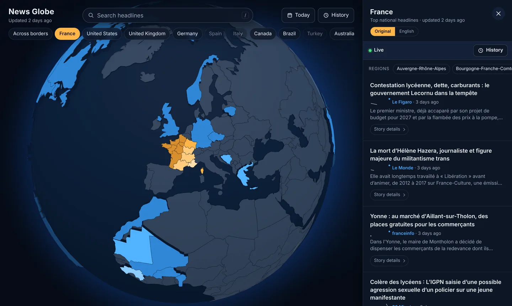
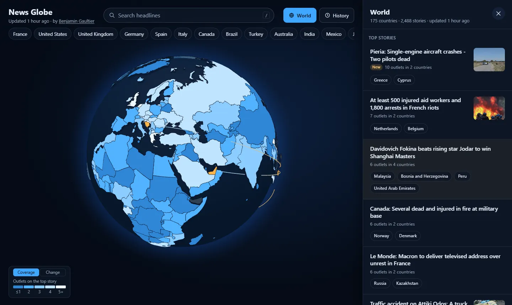

# news-globe

[](https://github.com/benjamin-gaultier/news-globe/actions/workflows/ci.yml) [](LICENSE)

An interactive 3D globe of the news. Click a country to see its top national headlines right now, grouped by story and ranked by how many outlets cover them.

**Live:** https://news-globe.maze-td.workers.dev · built by [Benjamin Gaultier](https://benjamingaultier.com/)



It covers 175 countries. Eleven of them (France, Germany, Spain, Italy, the US, Canada, Australia, Brazil, Mexico, Argentina and India) also split into regions with their own local headlines.

- **No LLM calls and no paid APIs** in the pipeline or the app: RSS plus hand-written text processing. (Claude only reviews pull requests.)
- **Metadata only:** headline, the feed's own snippet, link, source, time and image URL. No article text is stored or shown, and every headline links to the publisher.
- **Polite fetching:** a descriptive User-Agent, conditional GET, and at most one request per feed every 15 minutes.

## Features

- **World briefing:** the first screen. The top stories worldwide right now in one list, each with the countries whose headlines carry it; pointing at a story lights those countries on the globe. Below: rising this hour, and on top all day.
- **Globe:** countries shaded by how widely their top story is covered. Countries whose #1 story is new or rising pulse, and arcs join the countries sharing a story.
- **Country panel:** ranked stories with every outlet covering them, New and ↑ Rising badges, an Original / English toggle, and Sport and Business sections where outlets have those feeds.
- **Story pages:** rank through the day, all coverage in publishing order, and the same story in other countries.
- **Search:** countries and regions by name, and every current headline, as you type. The last countries you opened stay one tap away.
- **History:** replay any day hour by hour, from the world briefing or a country's panel.
- **Phones:** a bottom sheet, swipe between countries, installable, works offline.
- **Shareable links:** `/#FR`, `/#FR-BRE`, `/#FR.sport`, `/#FR/<story>`, `/#FR@2026-10-08T14:05`.



## Quick start

Requires Node ≥ 20.11 and pnpm (`corepack enable`).

```bash
pnpm install
pnpm dev            # web app on http://localhost:5173 (committed sample data)
pnpm ingest         # fetch the feeds once → data/
pnpm ingest:watch   # run now, then every hour
pnpm test           # unit tests
pnpm typecheck
pnpm check          # lint + formatting (Biome); `pnpm format` fixes formatting
pnpm --filter @news-globe/web e2e   # browser tests (Playwright)
```

## How it runs

```
Raspberry Pi                      Cloudflare (free tier)
pnpm ingest:watch  ── hourly ──▶  KV: one bundle of JSON files
 fetch → cluster → rank           Worker: static app + /data/* from KV
 + history, trends, translations
```

Everything is precomputed, so a click never runs a query. Every push to `main` that passes CI deploys the Worker. A GitHub workflow checks the live site hourly and archives any run the Pi missed.

## Repository

```
apps/web/          React + Vite front end (react-globe.gl) and the Cloudflare Worker
packages/ingest/   feeds → normalize → dedupe → cluster → rank → JSON, plus archive and translation
packages/shared/   data types and country/region metadata
deploy/            systemd unit for the Pi
docs/              the details
```

## Docs

- [How it works](docs/how-it-works.md): each feature, the architecture, the pipeline's steps and thresholds, the data files, next steps.
- [Operations](docs/operations.md): deploying, the Raspberry Pi setup, the health check, the history archive, auto-update, translation and the LLM review.
- [Sources](docs/sources.md): every feed and outlet by country, feed quirks, how to add a feed or a country, and map credits.

## Author

Built by [Benjamin Gaultier](https://benjamingaultier.com/), a full stack engineer in Paris. Issues and pull requests are welcome.

## License

The code is [MIT](LICENSE). Headlines, snippets and images belong to their publishers; the site only links to them. Security issues: see [SECURITY.md](SECURITY.md).
